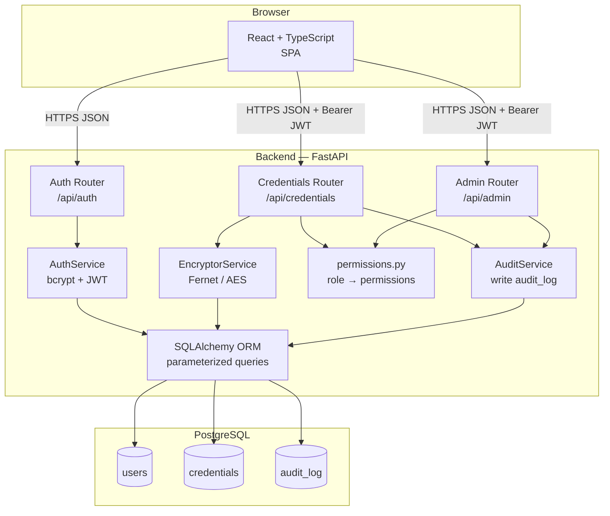
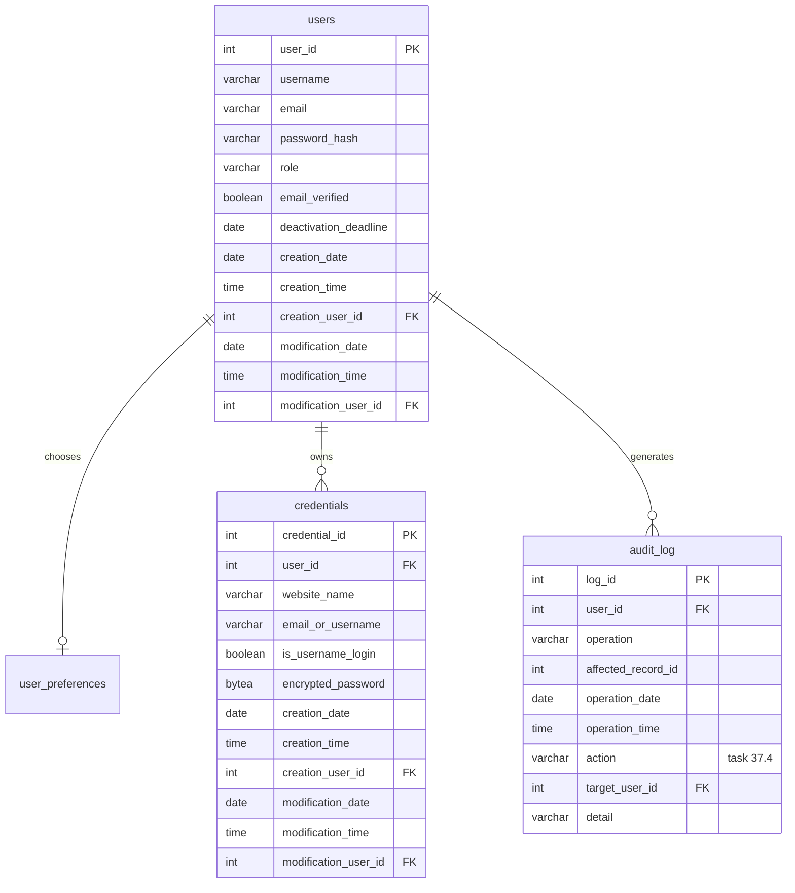
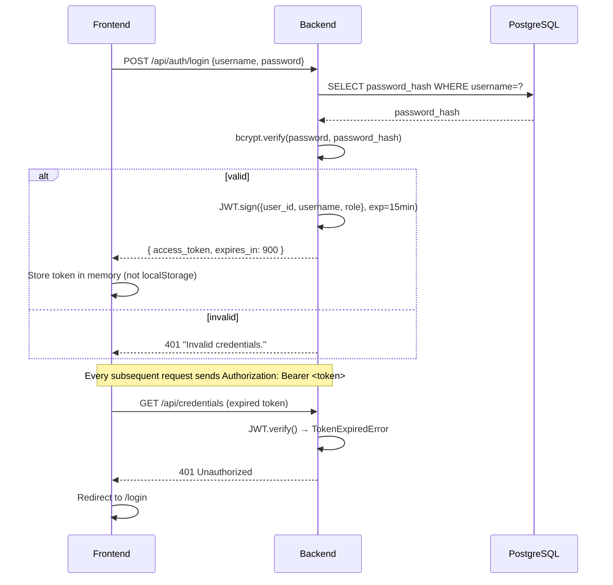

# Design Document — Password Manager Website

## Overview

The password manager website is a full-stack web application that lets authenticated users securely store, retrieve, edit, and delete credentials (website name + login + password). All encryption and decryption happen exclusively on the backend; the frontend never sees an encryption key or an unencrypted password from the database.

The system is built with:

- **Frontend**: React + TypeScript (Vite), using `react-i18next` for EN/ES internationalization.
- **Backend**: Python, FastAPI, SQLAlchemy ORM, `cryptography` (Fernet/AES-128-CBC), `bcrypt` (via `passlib`).
- **Database**: PostgreSQL 15.
- **Auth**: JWT (short-lived access token, HTTPS-only), issued by the backend on successful login.

Two roles exist: **User** and **Admin**, one per account. Each role grants a fixed set of per-action permissions defined in code (`app/permissions.py`); every endpoint asks for one and anything not granted is denied. Credentials are private to their owner for every role (task 37.1 retired Kiro's per-user screen profiles).

---

## Architecture

### High-Level Component Diagram



### Request Flow for a Credential Retrieval

```
1. User clicks Eye_Toggle in browser
2. Frontend prompts for account password (Password_Confirmation_Prompt modal)
3. User enters account password → frontend POSTs to /api/credentials/{id}/reveal
   with { "account_password": "..." } + Bearer JWT
4. Backend verifies JWT → extracts user_id
5. Backend fetches user.password_hash from DB
6. Backend verifies bcrypt(account_password, password_hash) → fail → 401
7. Backend fetches credential row (WHERE credential_id = ? AND user_id = ?)
8. Backend calls EncryptorService.decrypt(credential.encrypted_password)
9. Backend writes SELECT entry to audit_log
10. Backend returns { "password": "<plaintext>" } over HTTPS
11. Frontend displays plaintext; starts 60-second Visibility_Timer
12. Timer expires → Frontend masks password (no further backend call needed)
```

### Encryption Lifecycle

```
SAVE:
  plaintext_password  →  Fernet.encrypt(plaintext_password, KEY)  →  encrypted_bytes (stored in DB)

REVEAL:
  encrypted_bytes  →  Fernet.decrypt(encrypted_bytes, KEY)  →  plaintext_password  →  sent over HTTPS  →  displayed briefly

EDIT:
  new_plaintext_password  →  Fernet.encrypt(new_plaintext_password, KEY)  →  new_encrypted_bytes (replaces old row)
```

The `FERNET_KEY` is a 32-byte URL-safe base64 key read from a server-side environment variable. It is never included in any API response or log output.

---

## Components and Interfaces

### Backend Routers

| Router | Base Path | Responsibilities |
|--------|-----------|-----------------|
| `auth_router` | `/api/auth` | Register, login, logout, token refresh, `GET /config` (CAPTCHA site key, verification on/off), `POST /verify-email` (Phase 2) |
| `credentials_router` | `/api/credentials` | CRUD for credentials; reveal endpoint |
| `admin_router` | `/api/admin` | Accounts: listing, role change, deactivate / reactivate (`users.manage`); audit view (`audit.view`) |
| `profile_router` | `/api/profile` | The caller's role and permissions; resend the verification email |

### Backend Services

| Service | Key Methods |
|---------|-------------|
| `AuthService` | `register(payload)`, `login(payload) → JWT`, `verify_token(token) → user_id`, `check_account_password(user_id, raw_password) → bool` |
| `EncryptorService` | `encrypt(plaintext: str) → bytes`, `decrypt(ciphertext: bytes) → str` |
| `permissions` (module) | `PERMISSIONS`, `ROLE_PERMISSIONS`, `permissions_for(role) → frozenset[str]` |
| `AuditService` | `log(user_id, operation, affected_record_id)` |

### Frontend Pages and Routes

| Route | Page Component | Role Required |
|-------|---------------|---------------|
| `/login` | `LoginPage` | Public |
| `/signup` | `SignUpPage` | Public |
| `/` | `HomePage` | `credentials.view` (task 37.2) |
| `/credentials` | `ViewSearchPage` | `credentials.view` |
| `/credentials/new` | `SaveCredentialPage` | `credentials.create` |
| `/credentials/:id/edit` | `EditCredentialPage` | `credentials.edit` |
| `/admin/users` | `AdminUsersPage` | `users.manage` (Admin) |
| `/admin/audit` | `AdminAuditPage` | `audit.view` (Admin, task 37.4) |
| `/admin/settings` | `SystemSettingsPage` | `settings.manage` (Admin, task 37.5) |
| `/unlock?token=…` | `UnlockPage` | public (task 37.5) |
| `/settings` | `SettingsPage` | any signed-in user (task 37.3) |

### Frontend Shared Components

| Component | Purpose |
|-----------|---------|
| `PasswordInput` | Masked field + Eye_Toggle |
| `PasswordConfirmModal` | Reusable account-password prompt modal |
| `VisibilityTimer` | Hook + UI countdown for 60 s auto-mask |
| `LanguageToggle` | Header EN/ES switcher |
| `ProtectedRoute` | HOC that checks the session + the route's permission; redirects to 403 page or login |
| `ConfirmDeleteModal` | Generic confirmation modal for deletions |
| `AlreadyVisibleModal` | Warning modal when another password is already revealed |
| `SideNav`, `AccountMenu` | Grouped side menu and account menu of the shell (task 37.2) |
| `SearchBox`, `FilterSelect`, `ViewToggle`, `Pagination` | List controls (task 37.2) |
| `HelpTip` | ⓘ help tooltip next to a label (task 37.2) |
| `PreferencesProvider`, `Avatar`, `PrivacyToggle`, `ConfirmDialog` | Account preferences applied app-wide, avatar (picture → icon → initials), private-mode eye, generic destructive confirmation (task 37.3) |

### Application Shell and Interface Patterns *(task 37.2, Requirement 13)*

- **Side menu** declared in `frontend/src/config/navigation.tsx` (group + permission per entry): Home, Vault (My credentials, Save credential), Administration (Manage users), Help (task 37.6). Entries the user lacks are hidden; an empty group is not shown. Groups close by their title (remembered per device in `localStorage`); the group of the current screen stays open. On ≥ 768 px it collapses to an icon rail (`savepass-sidebar-collapsed`); below that it opens as a drawer that closes after choosing a screen or with Escape.
- **Account menu** (top right): initials avatar, username, role, Sign out. Settings join in task 37.3.
- **Home** (`/`, `credentials.view`): counts (total, email vs username sign-in) and the five most recently changed credentials, from `GET /api/credentials` (`last_changed`). Signing in lands here.
- **Lists** (`ViewSearchPage`, `AdminUsersPage`): the list is loaded once and filtered in the browser — accent- and case-insensitive search (`lib/text.ts`), filters with "All" first and options A–Z, pagination "X–Y of Z" with first / previous / next / last and 10/20/30/50/100 per page (`usePaged`; 10 in a list, 30 in cards; filters reset to page 1), distinct "nothing saved yet" and "no results" messages, and a list / cards switch saved in the account (`useListView` → `user_preferences.list_views`). The backend `q` parameter of `GET /api/credentials` stays for API clients; the page no longer uses it, so results follow every keystroke and accents are ignored on any database.
- **Forms**: required fields with a red asterisk; help in an ⓘ tooltip next to the label (`HelpTip`: hover, focus or tap; Escape closes); a failed submit marks the fields `aria-invalid`, focuses and scrolls to the first one (`useFocusFirstError`, only on submit so typing never loses focus) and shows a specific message under each field; pages are fresh on each visit (they remount); destructive actions confirm first; a disabled control carries a `title` saying why.

---

## Data Models

### Entity-Relationship Diagram



### Table DDL Summaries

```sql
-- users
CREATE TABLE users (
    user_id              SERIAL PRIMARY KEY,
    username             VARCHAR(64)  NOT NULL UNIQUE,
    email                VARCHAR(254) NOT NULL UNIQUE,
    password_hash        VARCHAR(128) NOT NULL,
    role                 VARCHAR(16)  NOT NULL CHECK (role IN ('User','Admin')),
    email_verified       BOOLEAN      NOT NULL DEFAULT FALSE,
    deactivation_deadline DATE,
    preferred_language   VARCHAR(8),          -- task 34.4: language of later emails
    last_verification_reminder_days SMALLINT, -- task 34.4: last reminder sent (days before deadline)
    user_code            VARCHAR(9)   NOT NULL UNIQUE, -- task 37.3: SP-XXXXXX, never changes
    display_name         VARCHAR(60),
    deactivated_at       TIMESTAMP,                    -- task 37.4: set by the Admin (UTC)
    deactivation_reason  VARCHAR(500),                 -- emailed to the person
    -- Audit columns
    creation_date        DATE         NOT NULL,
    creation_time        TIME         NOT NULL,
    creation_user_id     INTEGER      REFERENCES users(user_id),
    modification_date    DATE,
    modification_time    TIME,
    modification_user_id INTEGER      REFERENCES users(user_id)
);

-- profiles / user_profiles: dropped by migration 0006 (task 37.1)

-- user_preferences (task 37.2, migration 0007): one row per user, created on the first change
CREATE TABLE user_preferences (
    user_id              INTEGER PRIMARY KEY REFERENCES users(user_id) ON DELETE CASCADE,
    list_views           JSON    NOT NULL,          -- {"credentials": "list" | "grid", "users": ...}
    theme                VARCHAR(8)  NOT NULL DEFAULT 'system',   -- task 37.3 (migration 0008)
    accent               VARCHAR(10) NOT NULL DEFAULT 'indigo',
    start_page           VARCHAR(16) NOT NULL DEFAULT 'home',
    private_mode         BOOLEAN     NOT NULL DEFAULT FALSE,
    avatar_preset        VARCHAR(16),
    avatar_image         BYTEA,                      -- ≤ 256 KB, PNG/JPEG/WebP checked by signature
    avatar_mime          VARCHAR(16),
    creation_date        DATE    NOT NULL,
    creation_time        TIME    NOT NULL,
    creation_user_id     INTEGER REFERENCES users(user_id),
    modification_date    DATE,
    modification_time    TIME,
    modification_user_id INTEGER REFERENCES users(user_id)
);

-- credentials
CREATE TABLE credentials (
    credential_id        SERIAL  PRIMARY KEY,
    user_id              INTEGER NOT NULL REFERENCES users(user_id),
    website_name         VARCHAR(256) NOT NULL,
    email_or_username    VARCHAR(254) NOT NULL,
    is_username_login    BOOLEAN NOT NULL DEFAULT FALSE,
    encrypted_password   BYTEA   NOT NULL,
    creation_date        DATE    NOT NULL,
    creation_time        TIME    NOT NULL,
    creation_user_id     INTEGER REFERENCES users(user_id),
    modification_date    DATE,
    modification_time    TIME,
    modification_user_id INTEGER REFERENCES users(user_id)
);

-- audit_log
CREATE TABLE audit_log (
    log_id             SERIAL  PRIMARY KEY,
    user_id            INTEGER NOT NULL REFERENCES users(user_id),
    operation          VARCHAR(16) NOT NULL CHECK (operation IN ('SELECT','INSERT','UPDATE','DELETE')),
    affected_record_id INTEGER,
    operation_date     DATE    NOT NULL,
    operation_time     TIME    NOT NULL,
    action             VARCHAR(32),                        -- task 37.4: e.g. credential.reveal, user.deactivate
    target_user_id     INTEGER REFERENCES users(user_id),  -- the account an admin action was done to
    detail             VARCHAR(64)                         -- short, never secret (e.g. User→Admin)
);

-- Indexes
CREATE INDEX idx_credentials_user_id        ON credentials(user_id);
CREATE INDEX idx_credentials_website_name   ON credentials(website_name);
CREATE INDEX idx_credentials_email_username ON credentials(email_or_username);
CREATE INDEX idx_audit_log_user_id          ON audit_log(user_id);
CREATE INDEX idx_audit_log_date             ON audit_log(operation_date, operation_time);  -- task 37.4
```

### Application Database Role

```sql
CREATE ROLE app_user LOGIN PASSWORD '...';
GRANT SELECT, INSERT, UPDATE, DELETE ON ALL TABLES IN SCHEMA public TO app_user;
GRANT USAGE, SELECT ON ALL SEQUENCES IN SCHEMA public TO app_user;
-- No SUPERUSER, no schema ownership
```

### API Request / Response Shapes

#### `POST /api/auth/register`
```json
// Request
{ "username": "alice", "email": "alice@example.com",
  "password": "Secr3t!pass#1", "password_confirmation": "Secr3t!pass#1" }

// Response 201
{ "user_id": 42, "username": "alice", "role": "User" }
```

#### `POST /api/auth/login`
```json
// Request
{ "username": "alice", "password": "Secr3t!pass#1" }

// Response 200
{ "access_token": "<JWT>", "token_type": "bearer", "expires_in": 900 }

// Response 401 (invalid credentials — generic)
{ "detail": "Invalid credentials." }
```

#### `GET /api/credentials?q=github`
```json
// Response 200
[
  { "credential_id": 7, "website_name": "GitHub", "email_or_username": "alice@example.com",
    "is_username_login": false, "password": null, "last_changed": "2026-11-16T15:04:05Z" }
]
// Sorted by website name. last_changed (task 37.2) = last creation or edit, UTC.
// The SPA loads the whole list without q and filters locally (accent-insensitive).
```

#### `GET /api/profile/preferences` / `PUT /api/profile/preferences/list-view` *(task 37.2)*
```json
// GET — any authenticated user; empty until the first change
{ "list_views": { "credentials": "grid", "users": "list" } }
// PUT body
{ "key": "credentials", "view": "grid" }      // key: credentials | users, view: list | grid → 422 otherwise
// Response 200: the whole updated object
```

#### Settings endpoints *(task 37.3; any signed-in user, own account only)*
```json
// GET /api/profile/me
{ "user_id": 42, "user_code": "SP-7K3M9Q", "username": "alice", "display_name": null,
  "email": "alice@example.com", "role": "User", "email_verified": true,
  "preferences": { "list_views": {}, "theme": "system", "accent": "indigo", "start_page": "home",
                   "private_mode": false, "language": "en", "avatar_preset": null, "has_avatar_image": false } }
// PUT /api/profile/me                { "display_name": "Alicia" }   → 200 MeResponse; 422 invalid name
// PUT /api/profile/preferences       any of theme, accent, start_page, private_mode, language → 200 preferences; 422 unknown value
// PUT /api/profile/avatar/preset     { "preset": "rocket" }        → 200 preferences
// PUT /api/profile/avatar/image      raw PNG/JPEG/WebP body ≤ 256 KB → 200; 413 too big or empty; 415 other format
// GET /api/profile/avatar/image      → the picture (nosniff, CSP default-src 'none', no-store); 404 none
// DELETE /api/profile/avatar         → 200 preferences (initials)
// POST /api/profile/password         { "current_password", "new_password", "new_password_confirmation" }
//   → 204; 401 Account password verification failed.; 400 mismatch / {"password_errors": [...]} / same password
// GET /api/profile/sessions          → [{ "session_id", "user_agent", "client_ip", "started", "last_active", "current" }]
// DELETE /api/profile/sessions/{id}  → 204; 400 for the current one (use logout); 404 unknown or someone else's
```

#### `POST /api/credentials`
```json
// Request
{ "website_name": "GitHub", "email_or_username": "alice@example.com",
  "is_username_login": false, "password": "myGithubPass1!",
  "account_password": "Secr3t!pass#1" }

// Response 201
{ "credential_id": 7, "website_name": "GitHub" }
```

#### `POST /api/credentials/{id}/reveal`
```json
// Request
{ "account_password": "Secr3t!pass#1" }

// Response 200
{ "password": "myGithubPass1!" }

// Response 401 (wrong account password)
{ "detail": "Account password verification failed." }

// Response 403 (credential belongs to another user)
{ "detail": "Forbidden." }
```

#### `PUT /api/credentials/{id}`
```json
// Request
{ "website_name": "GitHub", "email_or_username": "alice@example.com",
  "is_username_login": false, "password": "newPass2@",
  "account_password": "Secr3t!pass#1" }

// Response 200
{ "credential_id": 7 }
```

#### `DELETE /api/credentials/{id}`
```json
// Request body
{ "account_password": "Secr3t!pass#1" }

// Response 204 (no body)
```

#### `GET /api/admin/users`
```json
// Response 200 (task 37.4 adds the user ID, status and deactivation)
[
  { "user_id": 42, "user_code": "SP-7K3M9Q", "username": "alice", "display_name": null,
    "email": "alice@example.com", "role": "User", "email_verified": true,
    "status": "deactivated",            // active | deactivated | unverified
    "deactivated_by": "admin",          // admin | deadline | null
    "deactivated_at": "2026-11-16T10:00:00Z", "deactivation_reason": "Left the team",
    "created": "2026-11-01T09:30:00Z" }
]
```

#### Account and audit endpoints *(task 37.4)*
```json
// POST /api/admin/users/{id}/deactivate  { "reason": "Left the team" }  (users.manage)
//   → 200 the account as in GET /users; 400 own account; 404; 409 already deactivated; 422 reason < 3 or > 500
// POST /api/admin/users/{id}/reactivate  (users.manage)
//   → 200 the account; 400 own account; 404; 409 not deactivated
// GET /api/admin/audit?action=user.role&q=alice&date_from=2026-11-01&date_to=2026-11-30  (audit.view)
{ "items": [ { "log_id": 9, "at": "2026-11-16T10:00:00Z", "action": "user.role",
               "actor":  { "user_id": 1, "user_code": "SP-AB23CD", "username": "boss" },
               "target": { "user_id": 42, "user_code": "SP-7K3M9Q", "username": "alice" },
               "record_id": null, "detail": "User→Admin" } ],
  "truncated": false }   // at most 1000 rows; 422 for an unknown action
```

#### `PUT /api/admin/users/{user_id}/role` *(task 37.1; replaces the profile assignment)*
```json
// Request
{ "role": "Admin" }

// Response 200
{ "user_id": 42, "role": "Admin" }
// 400 { "detail": "You cannot change your own role." } · 404 if the user does not exist · 422 for any other role
```

#### `POST /api/auth/refresh` / `POST /api/auth/logout` *(added in task 31.5)*
```json
// refresh — no body; uses the sp_refresh cookie. Response 200 (+ rotated cookie)
{ "access_token": "<JWT>", "token_type": "bearer", "expires_in": 900 }
// 401 { "detail": "Session expired." }
// logout — no body; 204, cookie cleared and token revoked
```

#### `GET /api/credentials/{id}` *(added in task 30.3)*
```json
// Response 200 — requires "credentials.view"; password is always null
{ "credential_id": 7, "website_name": "GitHub", "email_or_username": "alice@example.com",
  "is_username_login": false, "password": null }
// 403 if owned by another user, 404 if it does not exist
```

#### `GET /api/profile/permissions` *(added in task 30.2)*
```json
// Response 200 — any authenticated user
{ "role": "User", "permissions": ["credentials.create", "credentials.delete", "credentials.edit", "credentials.reveal", "credentials.view"] }
// Admin: the same plus "users.manage", "audit.view" and "settings.manage" (explicit list, no "*")
```

---

## Authentication and Session Management Flow



JWT Configuration:
- Algorithm: HS256
- Expiry: 15 minutes (access token)
- Transmission: HTTPS only; `Authorization: Bearer` header; token stored in React memory state (not `localStorage` or cookies) to reduce XSS exposure
- Login / refresh body (task 33): also `email_verification_required` (bool) and `deactivation_deadline` (ISO date or null); the frontend shows the verification modal after a login when the first is true.
- Claims: `user_id`, `username`, `role`, `exp`, and `sid` (task 37.3: the session; the token stops working as soon as that session ends). The frontend `AuthContext` rejects a token missing any of the first three (task 30.1).
- Refresh (task 31.5): login also sets an opaque refresh token in an `httpOnly; Secure; SameSite=Strict; Path=/api/auth` cookie (`sp_refresh`, lifetime `REFRESH_EXPIRE_HOURS`, default 8 h). Only its SHA-256 is stored in `refresh_tokens`. `POST /api/auth/refresh` rotates it and returns a new access token; reusing a rotated token revokes its whole family. `POST /api/auth/logout` revokes it. The SPA calls refresh once on page load (session restore) and once on an expired-token 401 before retrying the request; if refresh fails it goes to `/login`. The access token itself is still only in memory.
- A 401 whose detail is `"Account password verification failed."` is a wrong re-entered password, not an expired session: the frontend interceptor shows the inline error instead of redirecting (task 30.6).

---

### Personal Settings *(task 37.3, Requirement 14)*

- **`/settings`** (any signed-in user, from the account menu): Profile (user ID, username, email, role, display name, avatar), Preferences (language, start page, theme, accent, private mode), Password, Active sessions.
- **User ID** `users.user_code` = `SP-` + 6 characters from `23456789ABCDEFGHJKMNPQRSTUVWXYZ` (no 0/O/1/I/L), unique, assigned at creation (model default; migration 0008 gives existing accounts one) and never changed by any endpoint. `users.display_name` (2–60 letters, digits, spaces, `. , ' - _`; empty = username).
- **Preferences** live in `user_preferences` (theme `light|dark|system`, accent `indigo|blue|emerald|violet|rose|amber`, start page `home|credentials|credentials-new`, private mode); the language stays in `users.preferred_language` (also used for emails). The frontend `PreferencesProvider` loads `GET /api/profile/me` after sign-in and applies them everywhere. A language picked in this browser session wins over the account copy on load and is then saved to it, so a reload right after switching never reverts it.
- **Theme**: Tailwind palettes `gray, red, green, amber, yellow, indigo` and `white` read CSS variables (`src/theme.css`, generated by `scripts/generate-theme.mjs`). `html.dark` reverses every palette (50 ↔ 950) and turns `white` into a dark surface, so existing classes work in both themes; `indigo` is the accent (`html[data-accent]`). `public/theme-init.js` (a file, because the CSP forbids inline scripts) applies the theme saved on the device before the first paint.
- **Avatar**: one of 12 built-in drawings, or a picture re-encoded in the browser to a 256 px WebP square (drops metadata and payloads); the server accepts at most 256 KB, checks PNG/JPEG/WebP from the first bytes (never the declared type) and serves it only to its owner with `nosniff`, `default-src 'none'` and `no-store`. Initials otherwise.
- **Private mode** (eye in the top bar or Settings): usernames and emails in lists show as dots; saved in the account.
- **Password change** (`POST /api/profile/password`, rate-limited like the account-password checks): current password, sign-up policy, must differ; ends every other session (this one stays) and emails a security notice (`app/services/security_notice.py`, user's language).
- **Sessions**: a session is a refresh-token family. Rows keep the device's user agent and IP; the access token carries the family as `sid`, and `get_current_claims` rejects it with 401 `Session expired.` once the family has no live token — so logout, "End session" and a password change cut access immediately instead of after up to 15 minutes. `GET /api/profile/sessions` lists live families (last activity = last refresh); `DELETE /api/profile/sessions/{id}` ends another device's.

---

### User Administration and Audit View *(task 37.4, Requirement 15)*

- **Status** of an account (computed, not stored): `deactivated` when `users.deactivated_at` is set by the Admin, or when the email was not verified before `deactivation_deadline` (Requirement 2.9); otherwise `unverified` while verification is still pending; otherwise `active`. `is_deactivated()` (`app/phase2.py`) covers both causes, so sign-in (403 `Account deactivated.`, only after the password matched), refresh and the verification link all refuse a deactivated account.
- **Deactivate** (`POST /api/admin/users/{id}/deactivate`, `users.manage`): reason of 3–500 characters (spaces collapsed), never the Admin's own account (400), 409 if already deactivated. Sets `deactivated_at` / `deactivation_reason`, ends every session of the account (`revoke_all`, so its access tokens stop at once through `sid`), writes `user.deactivate` to `audit_log` and emails the reason in the person's language. Credentials are kept.
- **Reactivate** (`POST /api/admin/users/{id}/reactivate`): clears the Admin's deactivation; an account closed by the deadline gets a new one (same period as sign-up) and its reminders start again — it is not marked verified. 409 when the account is not deactivated. Emails the person.
- **Audit log** (`/admin/audit`, permission `audit.view`): `audit_log` gains `action` (`account.register|login|password`, `credential.create|edit|delete|reveal`, `user.role|deactivate|reactivate`), `target_user_id` and a short non-secret `detail` (`User→Admin`). Migration 0009 names the rows written before as their credential action. `GET /api/admin/audit?action=&q=&date_from=&date_to=` returns the latest 1000 matches newest first (`truncated` says when there were more); `q` matches the username, email or user ID of whoever did it or whoever it was done to (`%` and `_` are literal). Credentials appear by number only, never their site, login or password.
- Unlock and 2FA reset belong to 37.5 (they need the lockout and TOTP state).

---

### Account Security and System Parameters *(task 37.5, Requirement 16)*

Delivered in parts; each part is listed here when it lands.

**Lockout (16.2).** `users.failed_attempts` counts wrong passwords in a row (and, with 2FA, wrong codes); reaching `lockout_attempts` sets `users.locked_at` and emails a one-time unlock link (`account_tokens`, purpose `unlock`, 24 h, only its SHA-256 stored; a new link retires older ones). The response stays the generic 401, so the lock reveals nothing; the right password on a locked account gets 423 `Account locked.` (checked after the password, like deactivation). A locked account counts nothing more. Unlock: the link (`POST /api/auth/unlock`, used only when the person presses the button on `/unlock`, so mail scanners unlock nothing), the Admin (`POST /api/admin/users/{id}/unlock`, status `locked` in the users list), and — with the later parts — a valid second-step code or a password reset. A right password resets the count.

**System parameters (16.8).** `system_settings` (key → JSON value) holds only what the Admin changed; `app/services/system_settings.py` declares each parameter's default (= suggested value), range and group, and readers get the default when no row exists (values are clamped to the range on read). `GET /api/admin/settings` lists them with range and default; `PUT /api/admin/settings` checks every value before saving any (422 otherwise) and audits `settings.update` with the changed names only. Permission `settings.manage` (Admin). Screen `/admin/settings`.

| Parameter | Default | Range |
|---|---|---|
| `lockout_attempts` | 5 | 3–20 |
| `admin_reauth_minutes` | 5 | 0–60 (0 = every time) |
| `session_idle_minutes` | 15 | 5–240 |
| `session_max_minutes` | 480 | 60–1440 |
| `session_extend_minutes` | 30 | 5–240 |

**Two-step verification (16.1, 16.7).** TOTP per RFC 6238 (SHA-1, 6 digits, 30 s, ±1 step) in `app/utils/totp.py`, standard library only; a code is accepted once (`users.totp_last_step`). The secret is Fernet-encrypted like credentials (`users.totp_secret`; `rotate-fernet-key` rotates it too); a new device waits in `totp_pending_secret` until a code confirms it, so the working one is never lost halfway. 10 recovery codes `XXXXX-XXXXX` (≈50 bits) in `recovery_codes`, only SHA-256 stored; new codes replace all old ones.

Sign-in: `POST /api/auth/login` checks the password (counting failures) and then answers `{"mfa": "code" | "setup", "mfa_token"}` instead of a session — a 5-minute JWT of type `mfa` that no other endpoint accepts. `code` → `POST /api/auth/login/verify {mfa_token, code}` takes an app code or a recovery code (the response says `recovery_codes_left`); a wrong one counts toward the lockout, a valid one opens the session and lifts a lock (so a locked account with 2FA reaches the code step after the right password). `setup` (account without 2FA while `TWO_FACTOR_REQUIRED` is on) → `POST /api/auth/2fa/setup {mfa_token}` returns the secret and `otpauth://` link (QR drawn in the browser), `POST /api/auth/2fa/confirm {mfa_token, code}` turns it on, returns the 10 codes once, emails a notice and opens the session.

`TWO_FACTOR_REQUIRED` defaults to true and production refuses false at start-up; backend tests and the E2E server turn it off (an account that has 2FA always needs it). Settings → *Two-step verification* (`GET /api/profile/me` → `two_factor`): use a new phone (`POST /api/profile/2fa/setup {account_password}` + `/2fa/confirm {code}`), new recovery codes (`POST /api/profile/2fa/recovery-codes {account_password, code}`, app code only); both email a notice. A banner warns when 3 or fewer codes remain. The Admin resets another account's 2FA (`POST /api/admin/users/{id}/reset-2fa`: sessions end, email, next sign-in sets it up); for the Admin's own lost phone, `python -m app.cli reset-2fa --username <name>` (also unlocks).

---

## Role and Permission System

*(Task 37.1 — the owner chose one role per account and only User / Admin. Kiro's profiles, named lists of screens assigned per user, were retired by migration 0006: with two fixed roles they added a second, redundant source of truth.)*

```
User   →  credentials.view, credentials.create, credentials.edit, credentials.delete, credentials.reveal
Admin  →  everything User has + users.manage, audit.view, settings.manage
```

- Permissions are names defined in `app/permissions.py` (`PERMISSIONS`, `ROLE_PERMISSIONS`). Asking for an unknown name fails when the module loads, so a typo cannot silently deny or allow.
- Backend `require_permission(permission)`: decode the JWT → load the user → `permission in permissions_for(user.role)` → else 403 `Access denied.`. **No role bypass**: Admin passes because its set lists the permission. The role is read from the database on every request, so a role change applies to the next request rather than when the 15-minute token expires.
- Credentials stay owner-only for every role: queries always filter by the caller's `user_id` (Property 10). Admin cannot see anyone else's vault.
- Role change: `PUT /api/admin/users/{id}/role` (`users.manage`) sets the user's modification Audit_Columns; an Admin cannot change their own role, so at least one Admin always remains. New sign-ups are `User`; the first Admin comes from `python -m app.cli create-admin`.
- Frontend: `GET /api/profile/permissions` returns the role and the explicit list; the menu and `ProtectedRoute` check the route's permission (redirect to `/403` otherwise).

---

## Internationalization (i18n) Approach

Library: `react-i18next` with `i18next`.

Directory structure:
```
src/
  i18n/
    en.json   ← all English strings keyed by identifier
    es.json   ← all Spanish strings, same keys
  i18n.ts     ← i18next initialization; detects browser language, falls back to "en"
```

`LanguageToggle` component calls `i18n.changeLanguage("es" | "en")` — no page reload. The chosen language is stored in `sessionStorage` so it persists for the browser session but resets on new sessions.

All user-visible text — labels, placeholders, error messages, modal copy — uses `t("key")` from the `useTranslation` hook.

---

## Responsive UI Strategy

Breakpoints (Tailwind CSS defaults, or equivalent CSS variables):

| Breakpoint | Width |
|-----------|-------|
| `sm` | ≥ 640 px |
| `md` | ≥ 768 px |
| `lg` | ≥ 1024 px |
| `xl` | ≥ 1280 px |

Implementation:
- Fluid grid layout: single-column on mobile; from `md` the side menu is fixed on the left (collapsible to icons), below `md` it is a drawer (task 37.2). Card grids use 1 / 2 / 3 columns at base / `sm` / `lg`.
- All buttons, inputs, and icon controls have a minimum touch target of 44×44 px on screens < 768 px.
- The credentials table on `ViewSearchPage` is wrapped in a horizontally scrollable container (`overflow-x: auto`) so no columns are clipped on narrow screens.
- Form layouts stack vertically on mobile and align side-by-side on `md+`.

---

## Security Considerations

| Concern | Mitigation |
|---------|-----------|
| SQL injection | SQLAlchemy ORM + parameterized queries exclusively; no raw string interpolation |
| Password storage | bcrypt (`bcrypt` library; `passlib` removed in task 31.2); work factor ≥ 12 |
| Credential encryption | Fernet (AES-128-CBC + HMAC-SHA256); key stored in env var, never in code or DB |
| Token security | Access JWT (PyJWT) in memory only (not `localStorage`); 15-min expiry; `exp` and `type="access"` required. Refresh token only in an httpOnly cookie, rotated and revocable (task 31.5) |
| Secrets | App refuses to start without a ≥ 32-char `JWT_SECRET` and a valid `FERNET_KEY` (task 31.1) |
| Brute-force | Per-IP limits on login/register/refresh and per-user limits on account-password checks (slowapi, task 31.3); unknown usernames still pay the bcrypt cost. Production counters live in Redis, shared by all workers, with an in-memory per-IP fallback if Redis is down (task 34.2) |
| Local installation | Windows laptop (task 36): IIS + ARR on HTTPS 8443 with the same headers as Caddy, API on 127.0.0.1 as Network Service with its own Python, own PostgreSQL service with migrator/app/backup roles, encrypted backups + weekly restore test; device IP via `X-Client-IP` trusted only from 127.0.0.1 |
| Backups | Daily `pg_dump` (custom format, verified, 14-day retention) by the `backup` service; `scripts/restore-backup.sh` restores in one transaction (task 34.3) |
| HTTPS | Production: Caddy terminates TLS (automatic certificates), redirects HTTP→HTTPS and sets HSTS, CSP and other security headers (task 32.6) |
| CORS | FastAPI `CORSMiddleware` configured to allow only the known frontend origin |
| Brute-force (Phase 2 of the spec) | hCaptcha on the login form when `HCAPTCHA_SITE_KEY`/`HCAPTCHA_SECRET` are set; verified server-side before the password, fails closed (task 33.4) |
| Email verification (Phase 2) | `EMAIL_VERIFICATION_ENABLED`: one-time link (SHA-256 stored in `email_verification_tokens`, 48 h), deadline = creation + 30 days, login 403 after it; resend keeps the deadline; `app.cli verify-email` reactivates (task 33); reminder emails 7 and 1 days before the deadline from the hourly scheduler (task 34.4) |
| Credential ownership | All credential queries include `WHERE user_id = <authenticated_user_id>` |
| Fernet key rotation | `FERNET_KEY="<new>,<old>"` + `python -m app.cli rotate-fernet-key` re-encrypts every row in one transaction, no downtime (task 32.5, ARCHITECTURE.md §6) |
| Database privileges | Production API connects as `app_user` (DML only); migrations run separately as the owner (task 32.6) |
| Audit trail | Every mutation and every credential reveal is logged to `audit_log`, in the same transaction as the mutation (task 31.4) |
| Schema changes | Alembic migrations only; CI fails on model/migration drift (task 31.6) |

---

## Audit Logging Design

`AuditService.log(user_id, operation, affected_record_id)` is called synchronously before the API response is returned.

```python
def log(self, user_id: int, operation: str, affected_record_id: int | None):
    entry = AuditLog(
        user_id=user_id,
        operation=operation,           # "SELECT" | "INSERT" | "UPDATE" | "DELETE"
        affected_record_id=affected_record_id,
        operation_date=date.today(),
        operation_time=datetime.utcnow().time(),
    )
    self.db.add(entry)
    self.db.commit()
```

Events logged:

| Operation | Trigger |
|-----------|---------|
| `INSERT` | Credential created |
| `SELECT` | Credential password revealed |
| `UPDATE` | Credential updated |
| `DELETE` | Credential deleted |

---

## Correctness Properties

*A property is a characteristic or behavior that should hold true across all valid executions of a system — essentially, a formal statement about what the system should do. Properties serve as the bridge between human-readable specifications and machine-verifiable correctness guarantees.*

### Property 1: Password Confirmation Match

*For any* pair of strings `(password, confirmation)`, the registration endpoint SHALL accept the submission if and only if `password == confirmation`.

**Validates: Requirements 1.3, 1.4**

---

### Property 2: Password Strength Validation

*For any* candidate password string, the backend validator SHALL reject the string if and only if at least one of the following conditions holds: length < 12, no uppercase letter, no lowercase letter, no digit, or no symbol from `{@, $, !}`.

**Validates: Requirements 1.5, 1.6**

---

### Property 3: Account Password Hashing

*For any* valid registration payload, the value stored in `users.password_hash` SHALL be a valid bcrypt hash AND SHALL NOT equal the plaintext password submitted during registration.

**Validates: Requirements 1.7, 8.5**

---

### Property 4: Audit Columns on Creation

*For any* record created in `users` or `credentials`, the fields `creation_date`, `creation_time`, and `creation_user_id` SHALL all be non-null immediately after creation.

**Validates: Requirements 1.8, 4.11, 9.8**

---

### Property 5: Generic Error on Invalid Login

*For any* login attempt with credentials that do not match a stored user (wrong username, wrong password, or non-existent user), the response body SHALL be the same generic error message, providing no information about which field was incorrect.

**Validates: Requirements 2.3**

---

### Property 6: JWT Issued on Successful Login

*For any* successful login attempt, the response SHALL contain an `access_token` that is a structurally valid JWT with `user_id`, `username` and `role` claims and an `exp` claim set within 15 minutes of issue time.

**Validates: Requirements 2.4**

---

### Property 7: Non-Admin Denied Access to Admin Screens

*For any* request to an admin-only endpoint (e.g., `/api/admin/*`) made with a JWT whose `role` claim is `"User"`, the backend SHALL return HTTP 403 Forbidden.

**Validates: Requirements 3.2, 3.4, 3.6**

---

### Property 8: Role Change Updates Audit Columns

*For any* role change performed by an Admin on another account, the updated `users` record SHALL have non-null `modification_date`, `modification_time`, and `modification_user_id` columns set to the current timestamp and the performing admin's `user_id` *(task 37.1; was the profile assignment)*.

**Validates: Requirements 3.3**

---

### Property 9: Credential Encryption Invariant

*For any* credential password string submitted during a save or edit operation, the value stored in `credentials.encrypted_password` SHALL NOT equal the plaintext string AND SHALL be a valid Fernet token that decrypts back to the original plaintext.

**Validates: Requirements 4.10, 6.7, 8.1**

---

### Property 10: Credential Ownership Isolation

*For any* authenticated user U and any credential C owned by a different user V, all credential endpoints (list, reveal, edit, delete) SHALL deny U access to C and SHALL NOT include C in any response returned to U.

**Validates: Requirements 5.3, 8.2**

---

### Property 11: Search Filter Correctness

*For any* search query string Q and any set of credentials belonging to the authenticated user, every credential returned by `GET /api/credentials?q=Q` SHALL contain Q as a case-insensitive substring in either `website_name` or `email_or_username`.

**Validates: Requirements 5.2**

---

### Property 12: Password Confirmation Always Required for Reveal

*For any* sequence of Eye_Toggle interactions within a single session, each reveal attempt SHALL trigger the `Password_Confirmation_Prompt` — no session-level bypass is permitted.

**Validates: Requirements 5.13**

---

### Property 13: Audit Log Entry on Every Mutation and Reveal

*For any* credential operation (INSERT on save, SELECT on reveal, UPDATE on edit, DELETE on delete), an `audit_log` row SHALL exist with the correct `operation` value, the correct `user_id`, and the correct `affected_record_id` immediately after the operation completes.

**Validates: Requirements 4.12, 5.14, 6.9, 7.7**

---

### Property 14: Wrong Account Password Rejects Sensitive Operations

*For any* sensitive operation (save, reveal, edit, delete) submitted with an incorrect account password, the backend SHALL return a 401 error and SHALL NOT perform the requested mutation or decryption.

**Validates: Requirements 4.9, 6.6, 7.5**

---

### Property 15: Concurrent Operations Preserve Per-User Isolation

*For any* set of simultaneous credential operations by distinct users, no user's operation SHALL read, modify, or delete another user's credentials; each user's final data state SHALL reflect only their own operations.

**Validates: Requirements 8.7**

---

### Property 16: Email Validation Rejects Invalid Formats and Disposable Domains

*For any* string submitted as an email address, the validator SHALL accept the string if and only if it conforms to RFC 5321 format AND its domain is not on the disposable-domain blocklist.

**Validates: Requirements 4.13**

---

## Error Handling

| Scenario | HTTP Status | Response |
|----------|-------------|----------|
| Invalid JWT or missing auth header | 401 | `{"detail": "Not authenticated."}` |
| Expired JWT | 401 | `{"detail": "Token expired."}` |
| Missing / invalid / reused refresh cookie | 401 | `{"detail": "Session expired."}` (cookie cleared) |
| Too many attempts | 429 | `{"detail": "Too many attempts. Please wait a minute and try again."}` + `Retry-After` |
| Wrong account password on sensitive op | 401 | `{"detail": "Account password verification failed."}` |
| Accessing another user's credential | 403 | `{"detail": "Forbidden."}` |
| Missing permission | 403 | `{"detail": "Access denied."}` |
| Resource not found | 404 | `{"detail": "Not found."}` (also Phase 2 endpoints while the feature is off) |
| Unverified account past its deadline (login, link) | 403 | `{"detail": "Account deactivated."}` |
| CAPTCHA missing or rejected | 400 | `{"detail": "CAPTCHA verification failed."}` |
| Unknown, used or expired verification link | 400 | `{"detail": "Invalid or expired verification link."}` |
| Resend for an already verified email | 409 | `{"detail": "Email already verified."}` |
| Validation error (pydantic) | 422 | Pydantic error detail |
| Unexpected server error | 500 | `{"detail": "Internal server error."}` (no stack trace in production) |

FastAPI exception handlers are registered globally. Database errors (integrity violations, transaction rollbacks) are caught and re-raised as 500s with the stack trace written to server logs only.

---

## Testing Strategy

### Unit Tests (pytest)

Focus on:
- `EncryptorService.encrypt` / `decrypt` round-trip with fixed and random inputs
- `AuthService.check_account_password` correct and incorrect cases
- Password strength validator: known-failing and known-passing examples
- `permissions_for` for User and Admin roles; deny by default for unknown roles
- `AuditService.log` call verification using mocked DB session

### Property-Based Tests (Hypothesis — Python)

Each test runs a **minimum of 100 iterations**.

Library: [`hypothesis`](https://hypothesis.readthedocs.io/)

Tag format used in test docstrings: `Feature: password-manager-website, Property {N}: {short_text}`

| Test | Property | Iterations |
|------|----------|-----------|
| `test_password_confirmation_match` | Property 1 | 100 |
| `test_password_strength_validation` | Property 2 | 200 |
| `test_account_password_hashing` | Property 3 | 100 |
| `test_audit_columns_on_creation` | Property 4 | 100 |
| `test_generic_error_on_invalid_login` | Property 5 | 100 |
| `test_jwt_issued_on_login` | Property 6 | 100 |
| `test_non_admin_denied_admin_endpoints` | Property 7 | 100 |
| `test_credential_encryption_invariant` | Property 9 | 200 |
| `test_credential_ownership_isolation` | Property 10 | 100 |
| `test_search_filter_correctness` | Property 11 | 200 |
| `test_prompt_always_required_for_reveal` | Property 12 | 100 |
| `test_audit_log_on_every_operation` | Property 13 | 100 |
| `test_wrong_password_rejects_sensitive_ops` | Property 14 | 100 |
| `test_email_validation` | Property 16 | 200 |

Properties 8 (role change audit columns) and 15 (concurrent isolation) use mocked DB sessions and SQLAlchemy in-memory SQLite for property-level isolation; true concurrency is verified in a separate integration test.

### Integration Tests

- Full login → create credential → reveal → edit → delete flow against a test PostgreSQL instance
- Admin role change and permission enforcement end-to-end
- Concurrent writes from two simulated users verify row-level isolation
- Phase 2 (`tests/test_phase2_verification.py`, also on PostgreSQL in CI): file/SMTP email backends, link lifecycle, resend keeps the deadline, deactivation at login/refresh/link, CLI reactivation, CAPTCHA (mocked hCaptcha, fails closed), settings validation; Playwright runs with verification on

### Contract, Security and Migration Tests (added in tasks 30–31)

- `test_mvp_contract.py` — every endpoint and JWT claim the frontend relies on, against a full schema with seeded profiles (no Admin promotion shortcut)
- `test_security_hardening.py` — settings validation, legacy hash compatibility, token type/`exp`/`alg=none` rejection, rate limits, atomic audit, refresh rotation / reuse detection / logout
- `test_migrations.py` — `alembic upgrade head` matches the ORM (`alembic check`), downgrade works, a pre-Alembic database can be adopted

### End-to-End Tests (Playwright, task 30.10)

`frontend/e2e/mvp.e2e.ts` starts uvicorn (SQLite, migrations applied) and Vite, then drives Chromium through sign-up, login, save, search, reveal (wrong and right account password), edit, delete, language switch, page reload (session kept), logout (session revoked) and admin profile reassignment.

### Frontend Tests (Vitest + React Testing Library)

- `PasswordInput` Eye_Toggle shows/hides value
- `PasswordConfirmModal` submission calls correct callback
- `VisibilityTimer` masks password after 60 seconds (mocked timers)
- `AlreadyVisibleModal` "Continue" and "Cancel" paths
- `ProtectedRoute` redirects non-permitted users
- `LanguageToggle` switches all `t()` calls without reload
- `AppLayout` header: permission-filtered navigation, logout
- `apiClient` silent refresh + retry; no refresh on wrong account password or failed login
- `SessionBootstrap` restores the session after a reload

---

## Documentation Files

The repository SHALL include three documentation files:

### `README.md`
User-facing guide covering:
- Project description and key features
- Prerequisites and local setup (Docker Compose or manual)
- Environment variables required (names only, not values)
- How to run the development server and run tests
- Screen-by-screen user guide (Login, Sign-Up, View/Search, Save, Edit, Delete, Admin pages)
- Language switching and responsive use on mobile

### `ARCHITECTURE.md`
Technical reference (written in task 28.2, after tasks 30–31) covering:
- System component diagram
- Encryption lifecycle (Save → Store → Retrieve → Display)
- Authentication and session token flow
- Role and permission model
- Database schema overview (tables, relationships, audit columns)
- Fernet key management and rotation procedure
- Audit log structure and querying

### `requirements.md`
Already created — captures all functional and non-functional requirements in EARS notation.
