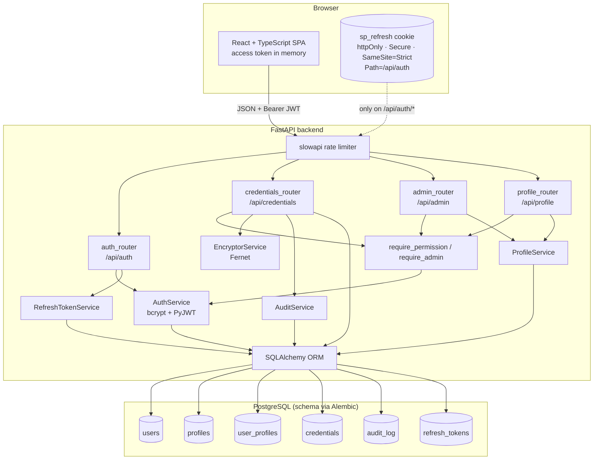
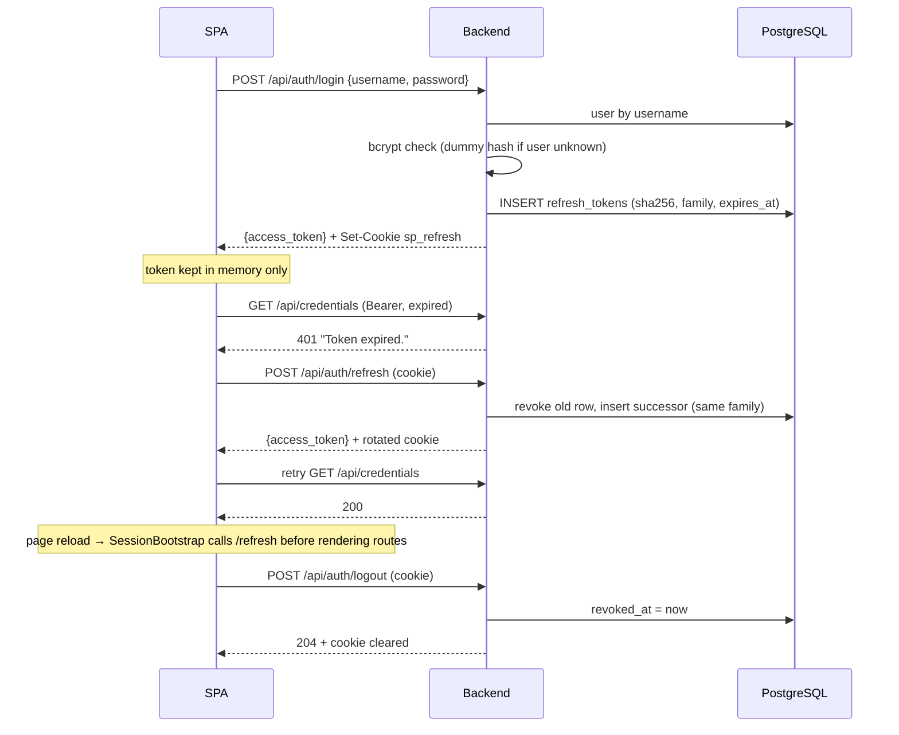
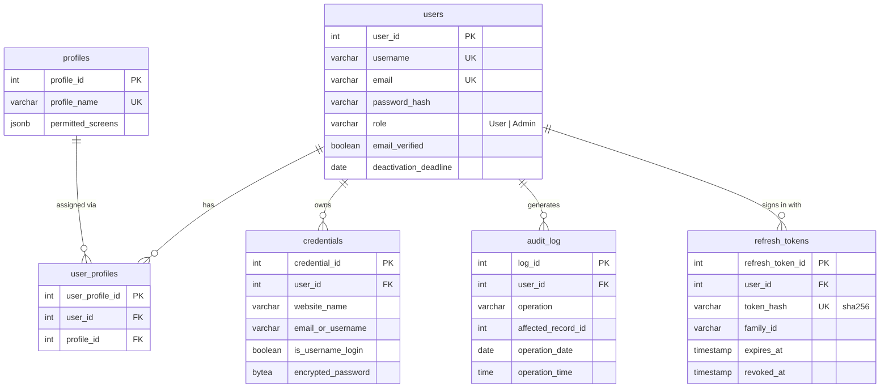
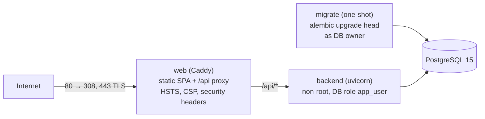

# Save-Pass — Architecture

Technical reference for developers and operators. It describes the system as implemented (tasks 1–31 in [`tasks.md`](.kiro/specs/password-manager-website/tasks.md)). Requirements live in [`requirements.md`](.kiro/specs/password-manager-website/requirements.md); API shapes and correctness properties in [`design.md`](.kiro/specs/password-manager-website/design.md).

---

## 1. System components



| Layer | Technology | Notes |
|---|---|---|
| Frontend | React 18, TypeScript, Vite, Tailwind, react-i18next, axios, React Router 6 | `AppLayout` header, `SessionBootstrap`, `ProtectedRoute` |
| Backend | FastAPI, SQLAlchemy 2, Pydantic 2 | Startup (`lifespan`) validates secrets and seeds profiles |
| Security libs | `cryptography` (Fernet), `bcrypt`, PyJWT, slowapi | `app/security.py`, `app/rate_limit.py` |
| Database | PostgreSQL 15; SQLite in tests | Alembic migrations in `backend/migrations` |
| Tests | pytest + Hypothesis, Vitest + RTL, Playwright | E2E runs against real uvicorn + Vite |

---

## 2. Encryption lifecycle

Saved credential passwords are encrypted **only on the backend** with Fernet (AES-128-CBC + HMAC-SHA256, random IV per message). Plaintext never touches the database, logs or list responses.

```
SAVE / EDIT
  browser ──HTTPS──▶ POST/PUT /api/credentials {password, account_password}
  backend: verify account password (bcrypt) ─▶ Fernet.encrypt(password)
           ─▶ credentials.encrypted_password (BYTEA) + audit_log row, one transaction

LIST / SEARCH
  GET /api/credentials?q=…  ─▶ rows owned by the user, "password": null

REVEAL
  POST /api/credentials/{id}/reveal {account_password}
  backend: ownership check ─▶ verify account password ─▶ Fernet.decrypt
           ─▶ audit_log SELECT row ─▶ {"password": "<plaintext>"} over HTTPS
  browser: shows it for 60 s (useVisibilityTimer), then masks it; nothing is cached
```

- The key comes from `FERNET_KEY` (server environment only; a comma-separated list during a rotation, section 6). It is never returned by the API or logged.
- The backend refuses to start if `FERNET_KEY` is missing or not a valid Fernet key (`validate_settings`).
- Every reveal requires the account password again; there is no "remember for this session".

---

## 3. Authentication and session

### Tokens

| | Access token | Refresh token |
|---|---|---|
| Format | JWT HS256 (PyJWT) | Opaque, 48 random bytes (`secrets.token_urlsafe`) |
| Claims / content | `user_id`, `username`, `role`, `type="access"`, `iat`, `exp` | none (random) |
| Lifetime | `JWT_EXPIRE_MINUTES` (15) | `REFRESH_EXPIRE_HOURS` (8) |
| Where it lives | React memory (`AuthContext` + `apiClient`), never storage | `sp_refresh` cookie: httpOnly, Secure, SameSite=Strict, Path=/api/auth |
| Server state | none (stateless) | `refresh_tokens` row with SHA-256 of the token |
| Revocation | expires | logout, rotation, reuse detection |

### Flow



Details:

- **Generic login errors**: every failed login returns `401 {"detail": "Invalid credentials."}`. Unknown usernames still run a bcrypt check against a dummy hash, so response time does not reveal which usernames exist.
- **Reuse detection**: presenting an already-rotated refresh token revokes every token in its family (the legitimate session too) and returns 401. This limits the value of a stolen cookie.
- **Wrong account password ≠ expired session**: `401 {"detail": "Account password verification failed."}` is shown inline in the modal; the client neither refreshes nor logs out.
- Concurrent refreshes in the SPA share one request, because rotation would invalidate the second.
- **Secrets**: the app does not start without `JWT_SECRET` of at least 32 characters (and not a known weak value). Tokens without `exp`, with `alg: none` or with `type` other than `access` are rejected.

### Rate limits (slowapi)

| Endpoint | Key | Default |
|---|---|---|
| `POST /api/auth/login` | client IP | 10/minute |
| `POST /api/auth/register` | client IP | 5/minute |
| `POST /api/auth/refresh` | client IP | 30/minute |
| save / reveal / edit / delete credential | user id from the token | 10/minute |

Exceeding a limit returns `429` with `Retry-After: 60`. Counters are in memory by default (`RATE_LIMIT_STORAGE=memory://`): with more than one worker or replica, point it to a shared store such as Redis.

---

## 4. Roles and permissions

```
Admin → every screen, every admin endpoint (role check only)
User  → screens listed in the assigned profile's permitted_screens
```

| Screen key | Grants |
|---|---|
| `credentials` | list/search, reveal |
| `credentials.new` | save |
| `credentials.edit` | open the edit page (`GET /api/credentials/{id}`), update |
| `credentials.delete` | delete |
| `admin.users`, `admin.profiles` | frontend routes; the API behind them is Admin-role only |

- **Backend**: `require_permission(screen)` decodes the JWT; Admin passes; a User passes only if `screen` is in their profile. `/api/admin/*` uses `require_admin`, which ignores profiles entirely (Property 7).
- **Frontend**: `ProtectedRoute` lets Admin through and asks `GET /api/profile/permissions` for Users; `AppLayout` hides links the user cannot open. The frontend check is for navigation only; the backend is the authority.
- **Seed**: on startup the backend creates the profiles **Basic** (`credentials`) and **Full** (all four credential screens) if missing. New sign-ups get `DEFAULT_PROFILE` (default `Full`). Admins are created with `python -m app.cli create-admin`; there is no sign-up path to Admin.
- **Ownership**: every single-credential query filters by `credential_id` **and** `user_id`. Admins manage profiles, not other users' vaults.

---

## 5. Database schema and migrations



**Audit columns.** Every table except `audit_log` carries `creation_date`, `creation_time`, `creation_user_id`, `modification_date`, `modification_time`, `modification_user_id` (Requirement 9.8). Times are UTC.

**Indexes.** `credentials(user_id)`, `credentials(website_name)`, `credentials(email_or_username)`, GIN trigram indexes on `credentials.website_name` and `credentials.email_or_username` (serve the `ILIKE '%q%'` search on PostgreSQL), `audit_log(user_id)`, `refresh_tokens(user_id)`, `refresh_tokens(family_id)`. Search input is escaped, so `%` and `_` match literally.

**Migrations.** Alembic is the only way the schema changes:

| Revision | Content |
|---|---|
| `0001_baseline` | users, profiles, user_profiles, credentials, audit_log |
| `0002_refresh_tokens` | refresh_tokens |
| `0003_search_trgm` | `pg_trgm` extension and GIN trigram indexes on `website_name` / `email_or_username` |

- Docker (`migrate` service in production) and the E2E tests run `alembic upgrade head` before the API starts. The app never creates tables.
- `backend/db/schema.sql` is **generated** from the migrations (`python db/generate_schema_sql.py`) and includes the `app_user` role with SELECT/INSERT/UPDATE/DELETE only (Requirement 9.9).
- `tests/test_migrations.py` fails when the ORM models and migrations differ.
- A database created before Alembic is adopted once with `alembic stamp 0001_baseline`, then `alembic upgrade head`.

---

## 6. Fernet key management and rotation

**Generate** a key and put it in `FERNET_KEY` (server environment / secret store, never in the repo):

```bash
python -c "from cryptography.fernet import Fernet; print(Fernet.generate_key().decode())"
```

Losing the key makes every saved credential unrecoverable: back it up with the same care as the database backups, and store the two separately.

**Rotate** without downtime (task 32.5). `FERNET_KEY` accepts several comma-separated keys: new data is encrypted with the **first** one and any listed key can decrypt.

1. Take a database backup and generate the new key.
2. Set `FERNET_KEY="<new>,<old>"` and restart the backend. Everything keeps working; new saves already use the new key.
3. Re-encrypt every stored credential with the new key, in one transaction (all rows or none):

   ```bash
   python -m app.cli rotate-fernet-key --dry-run   # checks every row decrypts, changes nothing
   python -m app.cli rotate-fernet-key
   # production: docker compose -f docker-compose.prod.yml exec backend python -m app.cli rotate-fernet-key
   ```

   If any row cannot be decrypted with the listed keys, the command stops and changes nothing.
4. Set `FERNET_KEY="<new>"` and restart.
5. Reveal one known credential to confirm, then destroy the old key once backups encrypted with it have expired.

---

## 7. Audit log

`audit_log` is append-only from the application's point of view (no update or delete code paths).

| Column | Meaning |
|---|---|
| `log_id` | primary key |
| `user_id` | who performed the action |
| `operation` | `INSERT` save · `SELECT` reveal · `UPDATE` edit · `DELETE` delete |
| `affected_record_id` | `credential_id` |
| `operation_date`, `operation_time` | when (UTC) |

- Save, edit and delete write the credential change and the audit row **in the same transaction**: either both persist or neither (task 31.4).
- A reveal writes its `SELECT` row before the plaintext is returned.
- Listing/searching and failed attempts are not logged here; failed logins and rate-limit hits only appear in server logs.

Useful queries:

```sql
-- Recent activity of one user
SELECT operation, affected_record_id, operation_date, operation_time
FROM audit_log WHERE user_id = :user_id
ORDER BY operation_date DESC, operation_time DESC LIMIT 50;

-- Who revealed a given credential
SELECT user_id, operation_date, operation_time
FROM audit_log WHERE operation = 'SELECT' AND affected_record_id = :credential_id;
```

---

## 8. Deployment

Production runs with [`docker-compose.prod.yml`](docker-compose.prod.yml) (task 32.6):



| Service | Role |
|---|---|
| `web` | Caddy 2: serves the built SPA, proxies `/api/*`, obtains a Let's Encrypt certificate for `SITE_ADDRESS` (internal CA for `localhost`), redirects HTTP to HTTPS, sets HSTS, CSP, `X-Frame-Options: DENY`, `nosniff`, `Referrer-Policy: no-referrer`. The only published service. |
| `migrate` | Runs `alembic upgrade head` as the database owner, then exits. The API starts only if it succeeded. |
| `backend` | FastAPI as a non-root user, connected as **`app_user`** (SELECT/INSERT/UPDATE/DELETE and sequence usage only, Requirement 9.9). Trusts `X-Forwarded-For` from Caddy, so rate limits see client IPs. Health check: `GET /api/health`. |
| `db` | PostgreSQL 15. `deploy/postgres/01-app-user.sh` creates `app_user` on first start, with default privileges so tables added by later migrations are covered. |

Frontend and API share one origin, so the refresh cookie (`SameSite=Strict`) and CORS need no cross-site configuration.

`scripts/smoke-prod.sh` builds and starts this stack with throwaway secrets and checks TLS, headers, a full API round trip through Caddy, audit rows, and that `app_user` cannot drop, create or truncate tables. CI runs it on every push.

### Continuous integration

`.github/workflows/ci.yml` runs on every push and pull request:

| Job | Checks |
|---|---|
| Backend | ruff, pip-audit, full pytest suite (SQLite), migrations upgrade/check/downgrade on PostgreSQL 15, API/security/key-rotation tests on PostgreSQL 15 |
| Frontend | eslint, `tsc`, Vitest, production build, `npm audit --audit-level=high` |
| End-to-end | Playwright against uvicorn + Vite with PostgreSQL 15 |
| Production | `scripts/smoke-prod.sh` (Docker images, Caddy, app_user) |

---

## 9. Known gaps

- **Rate-limit counters** live in each process's memory. Production runs a single uvicorn worker; scaling out needs `RATE_LIMIT_STORAGE` pointing to a shared store such as Redis.
- **react-router 6** has a moderate open-redirect advisory fixed only in v7 (task 31.8); not reachable because the app navigates only to static paths.
- **Backups** are not automated; schedule `pg_dump` of the `postgres_data` volume and keep the Fernet key stored separately.
- **Spec Phase 2** (CAPTCHA, email verification, account deactivation) is not implemented.
