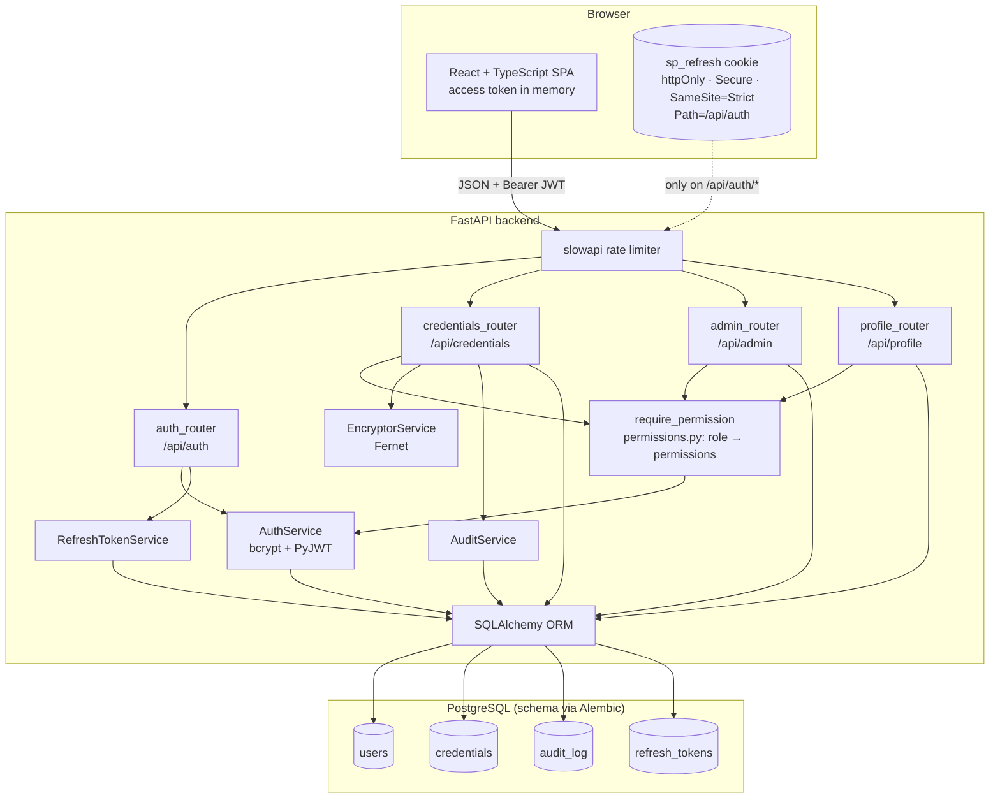
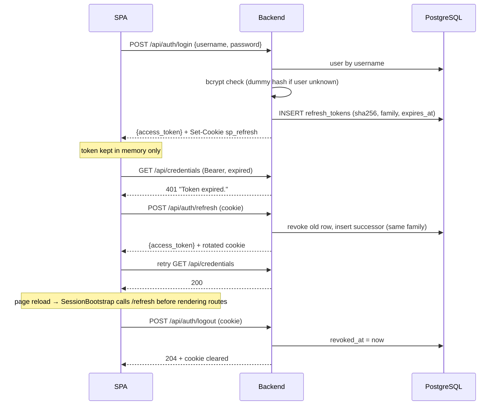
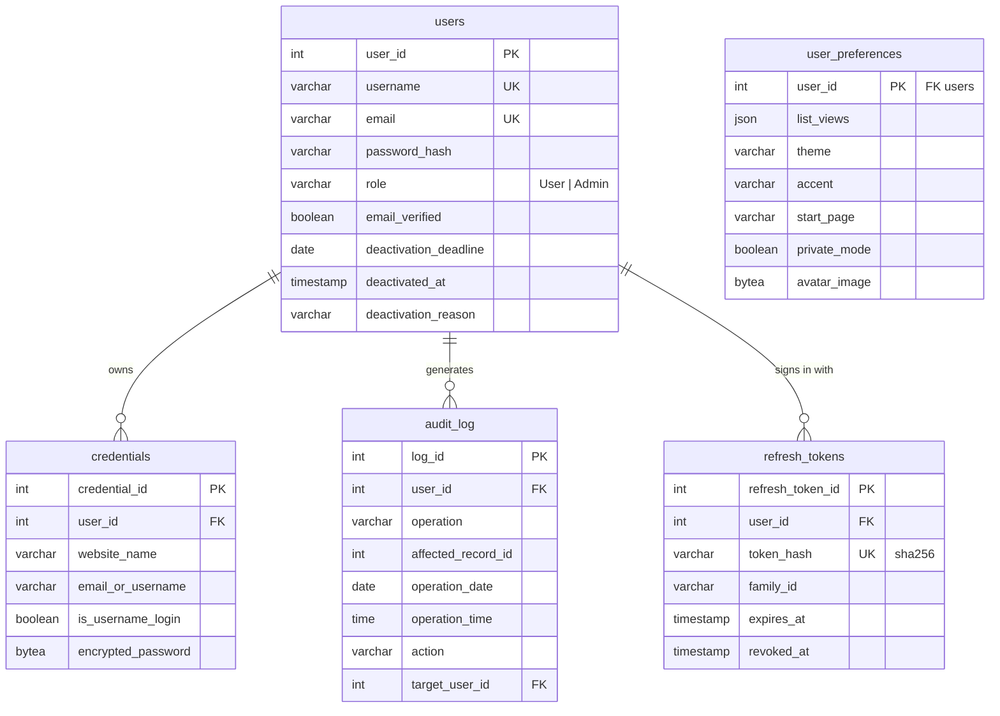
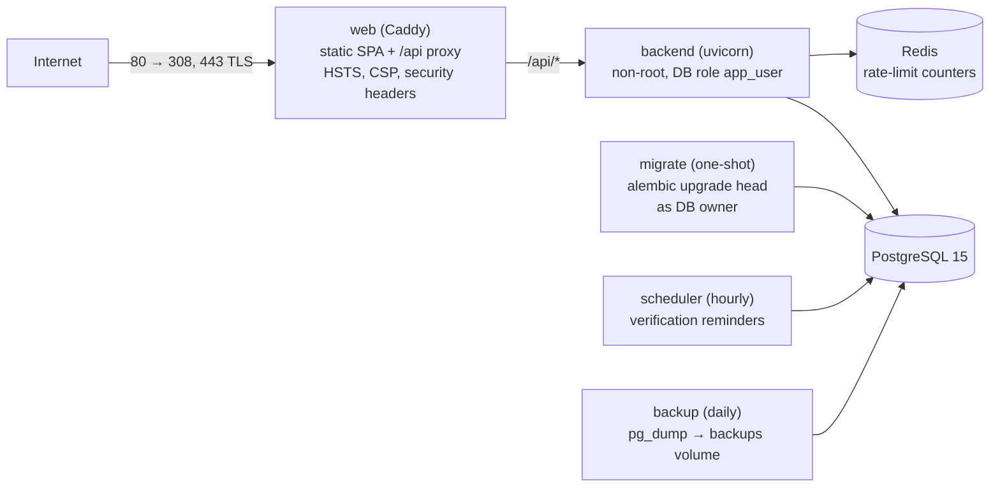

# Save-Pass — Architecture

Technical reference for developers and operators. It describes the system as implemented (tasks 1–31 in [`tasks.md`](.kiro/specs/password-manager-website/tasks.md)). Requirements live in [`requirements.md`](.kiro/specs/password-manager-website/requirements.md); API shapes and correctness properties in [`design.md`](.kiro/specs/password-manager-website/design.md).

---

## 1. System components



| Layer | Technology | Notes |
|---|---|---|
| Frontend | React 18, TypeScript, Vite, Tailwind, react-i18next, axios, React Router 7 | `AppLayout` header, `SessionBootstrap`, `ProtectedRoute` |
| Backend | FastAPI, SQLAlchemy 2, Pydantic 2 | Startup (`lifespan`) validates secrets; no seed data |
| Security libs | `cryptography` (Fernet), `bcrypt`, PyJWT, slowapi | `app/security.py`, `app/rate_limit.py` |
| Database | PostgreSQL 15; SQLite in tests | Alembic migrations in `backend/migrations` |
| Tests | pytest + Hypothesis, Vitest + RTL, Playwright | E2E runs against real uvicorn + Vite |

**Frontend shell (task 37.2).** `AppLayout` renders the grouped side menu (`config/navigation.tsx`, one permission per entry; collapsible to icons on wide screens, a drawer on phones) and the account menu. Lists load once and filter, paginate and switch list / cards in the browser; the list / cards choice is saved in the account (`user_preferences`). Forms share `HelpTip` (ⓘ help) and `useFocusFirstError` (focus the first invalid field after a failed submit). Signing in opens Home (`/`), or the start page chosen in Settings.

**Settings and sessions (task 37.3).** `/settings` holds profile (immutable `SP-XXXXXX` user ID, display name, avatar), preferences (language, theme, accent, start page, private mode), password change and active sessions. Theme and accent are CSS variables (`src/theme.css`): dark mode reverses the palettes, so pages need no `dark:` classes; `public/theme-init.js` paints the saved theme first. Each access token carries its session (`sid`); the API rejects it once that session ends, so logout, ending a session from Settings or changing the password cut access at once.

**User administration and audit (task 37.4).** The Admin deactivates another account with a reason (sessions end at once, the person gets the reason by email, credentials are kept) and reactivates it from `/admin/users`, which also searches by user ID and filters by status. `/admin/audit` (`audit.view`) lists sign-ups, sign-ins, password changes, credential operations and admin actions with filters; `audit_log.action` names each event and credentials appear by number only.

---

## 2. Encryption lifecycle

Saved credential passwords are encrypted **only on the backend** with Fernet (AES-128-CBC + HMAC-SHA256, random IV per message). Plaintext never touches the database, logs or list responses.

```
SAVE / EDIT
  browser ──HTTPS──▶ POST/PUT /api/credentials {password, account_password}
  backend: verify account password (bcrypt) ─▶ Fernet.encrypt(password)
           ─▶ credentials.encrypted_password (BYTEA) + audit_log row, one transaction

LIST / SEARCH
  GET /api/credentials?q=…  ─▶ rows owned by the user, "password": null

REVEAL
  POST /api/credentials/{id}/reveal {account_password}
  backend: ownership check ─▶ verify account password ─▶ Fernet.decrypt
           ─▶ audit_log SELECT row ─▶ {"password": "<plaintext>"} over HTTPS
  browser: shows it for 60 s (useVisibilityTimer), then masks it; nothing is cached
```

- The key comes from `FERNET_KEY` (server environment only; a comma-separated list during a rotation, section 6). It is never returned by the API or logged.
- The backend refuses to start if `FERNET_KEY` is missing or not a valid Fernet key (`validate_settings`).
- Every reveal requires the account password again; there is no "remember for this session".

---

## 3. Authentication and session

### Tokens

| | Access token | Refresh token |
|---|---|---|
| Format | JWT HS256 (PyJWT) | Opaque, 48 random bytes (`secrets.token_urlsafe`) |
| Claims / content | `user_id`, `username`, `role`, `type="access"`, `iat`, `exp` | none (random) |
| Lifetime | `JWT_EXPIRE_MINUTES` (15) | `REFRESH_EXPIRE_HOURS` (8) |
| Where it lives | React memory (`AuthContext` + `apiClient`), never storage | `sp_refresh` cookie: httpOnly, Secure, SameSite=Strict, Path=/api/auth |
| Server state | none (stateless) | `refresh_tokens` row with SHA-256 of the token |
| Revocation | expires | logout, rotation, reuse detection |

### Flow



Details:

- **Generic login errors**: every failed login returns `401 {"detail": "Invalid credentials."}`. Unknown usernames still run a bcrypt check against a dummy hash, so response time does not reveal which usernames exist.
- **Reuse detection**: presenting an already-rotated refresh token revokes every token in its family (the legitimate session too) and returns 401. This limits the value of a stolen cookie.
- **Wrong account password ≠ expired session**: `401 {"detail": "Account password verification failed."}` is shown inline in the modal; the client neither refreshes nor logs out.
- Concurrent refreshes in the SPA share one request, because rotation would invalidate the second.
- **Secrets**: the app does not start without `JWT_SECRET` of at least 32 characters (and not a known weak value). Tokens without `exp`, with `alg: none` or with `type` other than `access` are rejected.

### Rate limits (slowapi)

| Endpoint | Key | Default |
|---|---|---|
| `POST /api/auth/login` | client IP | 10/minute |
| `POST /api/auth/register` | client IP | 5/minute |
| `POST /api/auth/refresh` | client IP | 30/minute |
| save / reveal / edit / delete credential | user id from the token | 10/minute |
| `POST /api/auth/verify-email` | client IP | 10/minute |
| `POST /api/profile/verification-email` (resend) | user id from the token | 3/hour |

Exceeding a limit returns `429` with `Retry-After: 60`. Counters are in memory by default (`RATE_LIMIT_STORAGE=memory://`): with more than one worker or replica, point it to a shared store such as Redis.

---

### Email verification, deactivation and CAPTCHA (spec Phase 2, tasks 33–34)

Both features are **off by default** and switched on by configuration; the backend refuses to start when they are half-configured.

| Setting | Effect |
|---|---|
| `EMAIL_VERIFICATION_ENABLED=true` | Sign-up stores `deactivation_deadline = creation date + 30 days` and sends a verification email. |
| `HCAPTCHA_SITE_KEY` + `HCAPTCHA_SECRET` | `POST /api/auth/login` requires a valid `captcha_token`, checked with hCaptcha before the password. |

- **Links.** `secrets.token_urlsafe(32)`; only the SHA-256 is stored in `email_verification_tokens` (migration 0004). A link works once and expires after `VERIFICATION_TOKEN_HOURS` (48). The link points to the SPA (`APP_BASE_URL/verify-email?token=…`), which POSTs the token to `/api/auth/verify-email`, so mail scanners that only open the page do not consume it. The page sends `Referrer-Policy: no-referrer` (Caddy).
- **Resend** (`POST /api/profile/verification-email`, logged-in user) issues a new link and never changes the deadline (Requirement 2.8). Earlier links keep working until they expire.
- **Login.** `/api/auth/login` and `/api/auth/refresh` return `email_verification_required` and `deactivation_deadline`; the SPA shows the reminder modal after a login. Once the deadline has passed (the day after it) an unverified account gets `403 "Account deactivated."` — only after the password matched, so nothing leaks to someone without it. An open session ends at the next refresh. Verifying with an old link is refused too; `python -m app.cli verify-email --username X` reactivates the account.
- Accounts without a deadline (created before the feature was switched on, or with `create-admin`) are never deactivated automatically.
- **Reminders** (task 34.4): `python -m app.cli send-verification-reminders` (hourly in the `scheduler` service) emails a new link `VERIFICATION_REMINDER_DAYS` before the deadline (default 7 and 1 days), each at most once; if a run was missed only the latest one goes out. `users.last_verification_reminder_days` records what was sent; emails use `users.preferred_language` (stored at sign-up and on resend).
- **Email delivery** (`EMAIL_BACKEND`): `console` prints the email, `smtp` sends it (`SMTP_*`, STARTTLS by default), `file` writes JSON files (E2E tests). Sending runs after the response; a failure is logged and the user can resend.
- **CAPTCHA** fails closed: missing token, rejected token or unreachable hCaptcha → `400 "CAPTCHA verification failed."`. The SPA loads `js.hcaptcha.com` only when `GET /api/auth/config` returns a site key; the production CSP allows `hcaptcha.com` for scripts, frames, styles and connections.

---

## 4. Roles and permissions

One role per account, and only two roles (task 37.1, the owner's decision). Kiro's per-user screen profiles were retired by migration `0006`: with two fixed roles they were a second, redundant source of truth.

| Permission | Grants | User | Admin |
|---|---|:-:|:-:|
| `credentials.view` | list/search, open the edit page (`GET /api/credentials/{id}`) | ✓ | ✓ |
| `credentials.create` | save | ✓ | ✓ |
| `credentials.edit` | update | ✓ | ✓ |
| `credentials.delete` | delete | ✓ | ✓ |
| `credentials.reveal` | show a saved password | ✓ | ✓ |
| `users.manage` | list users, change another user's role | | ✓ |

- **Backend**: `app/permissions.py` holds the names and `ROLE_PERMISSIONS`. `require_permission(name)` validates the JWT, loads the user and allows only if their **current** role grants the name: no role bypass, deny by default, and a role change applies to the next request. Naming an unknown permission fails when the module loads. `tests/test_permissions.py` checks that every non-public endpoint authenticates and which permission each credential/admin endpoint asks for.
- **Frontend**: `ProtectedRoute` and `AppLayout` both use `GET /api/profile/permissions` (an explicit list for every role). The frontend check is for navigation only; the backend is the authority.
- **Roles**: new sign-ups are `User`; the first Admin comes from `python -m app.cli create-admin` (or `promote`). On `/admin/users` an Admin changes another account's role (`PUT /api/admin/users/{id}/role`, modification Audit_Columns set); nobody can change their own role, so one Admin always remains.
- **Ownership**: every credential query filters by the caller's `user_id`. Admin manages accounts, never other users' vaults.

---

## 5. Database schema and migrations



**Audit columns.** Every table except `audit_log` carries `creation_date`, `creation_time`, `creation_user_id`, `modification_date`, `modification_time`, `modification_user_id` (Requirement 9.8). Times are UTC.

**Indexes.** `credentials(user_id)`, `credentials(website_name)`, `credentials(email_or_username)`, GIN trigram indexes on `credentials.website_name` and `credentials.email_or_username` (serve the `ILIKE '%q%'` search on PostgreSQL), `audit_log(user_id)`, `refresh_tokens(user_id)`, `refresh_tokens(family_id)`. Search input is escaped, so `%` and `_` match literally.

**Migrations.** Alembic is the only way the schema changes:

| Revision | Content |
|---|---|
| `0001_baseline` | users, profiles, user_profiles, credentials, audit_log |
| `0002_refresh_tokens` | refresh_tokens |
| `0003_search_trgm` | `pg_trgm` extension and GIN trigram indexes on `website_name` / `email_or_username` |
| `0004_email_verification` | email_verification_tokens (spec Phase 2) |
| `0005_verification_reminders` | `users.preferred_language`, `users.last_verification_reminder_days` |
| `0006_retire_profiles` | drops profiles and user_profiles (permissions come from the role); its downgrade restores them and links every User to Full |
| `0007_user_preferences` | user_preferences (list / cards per listing, saved in the account; task 37.2) |
| `0008_settings` | users.user_code (backfilled, unique) and display_name; theme, accent, start page, private mode and avatar in user_preferences; user agent and IP on refresh_tokens (task 37.3) |
| `0009_user_admin` | users.deactivated_at and deactivation_reason; audit_log.action (backfilled for old rows), target_user_id, detail and a date index (task 37.4) |
| `0010_lockout_settings` | users.failed_attempts and locked_at; account_tokens (one-time unlock / reset links); system_settings (task 37.5) |

- Docker (`migrate` service in production) and the E2E tests run `alembic upgrade head` before the API starts. The app never creates tables.
- `backend/db/schema.sql` is **generated** from the migrations (`python db/generate_schema_sql.py`) and includes the `app_user` role with SELECT/INSERT/UPDATE/DELETE only (Requirement 9.9).
- `tests/test_migrations.py` fails when the ORM models and migrations differ.
- A database created before Alembic is adopted once with `alembic stamp 0001_baseline`, then `alembic upgrade head`.

---

## 6. Fernet key management and rotation

**Generate** a key and put it in `FERNET_KEY` (server environment / secret store, never in the repo):

```bash
python -c "from cryptography.fernet import Fernet; print(Fernet.generate_key().decode())"
```

Losing the key makes every saved credential unrecoverable: back it up with the same care as the database backups, and store the two separately.

**Rotate** without downtime (task 32.5). `FERNET_KEY` accepts several comma-separated keys: new data is encrypted with the **first** one and any listed key can decrypt.

1. Take a database backup and generate the new key.
2. Set `FERNET_KEY="<new>,<old>"` and restart the backend. Everything keeps working; new saves already use the new key.
3. Re-encrypt every stored credential with the new key, in one transaction (all rows or none):

   ```bash
   python -m app.cli rotate-fernet-key --dry-run   # checks every row decrypts, changes nothing
   python -m app.cli rotate-fernet-key
   # production: docker compose -f docker-compose.prod.yml exec backend python -m app.cli rotate-fernet-key
   ```

   If any row cannot be decrypted with the listed keys, the command stops and changes nothing.
4. Set `FERNET_KEY="<new>"` and restart.
5. Reveal one known credential to confirm, then destroy the old key once backups encrypted with it have expired.

---

## 7. Audit log

`audit_log` is append-only from the application's point of view (no update or delete code paths).

| Column | Meaning |
|---|---|
| `log_id` | primary key |
| `user_id` | who performed the action |
| `operation` | `INSERT` save · `SELECT` reveal · `UPDATE` edit · `DELETE` delete |
| `affected_record_id` | `credential_id` |
| `operation_date`, `operation_time` | when (UTC) |

- Save, edit and delete write the credential change and the audit row **in the same transaction**: either both persist or neither (task 31.4).
- A reveal writes its `SELECT` row before the plaintext is returned.
- Listing/searching and failed attempts are not logged here; failed logins and rate-limit hits only appear in server logs.

Useful queries:

```sql
-- Recent activity of one user
SELECT operation, affected_record_id, operation_date, operation_time
FROM audit_log WHERE user_id = :user_id
ORDER BY operation_date DESC, operation_time DESC LIMIT 50;

-- Who revealed a given credential
SELECT user_id, operation_date, operation_time
FROM audit_log WHERE operation = 'SELECT' AND affected_record_id = :credential_id;
```

---

## 8. Deployment

Production runs with [`docker-compose.prod.yml`](docker-compose.prod.yml) (task 32.6):



| Service | Role |
|---|---|
| `web` | Caddy 2: serves the built SPA, proxies `/api/*`, obtains a Let's Encrypt certificate for `SITE_ADDRESS` (internal CA for `localhost`), redirects HTTP to HTTPS, sets HSTS, CSP, `X-Frame-Options: DENY`, `nosniff`, `Referrer-Policy: no-referrer`. The only published service. |
| `migrate` | Runs `alembic upgrade head` as the database owner, then exits. The API starts only if it succeeded. |
| `backend` | FastAPI as a non-root user, connected as **`app_user`** (SELECT/INSERT/UPDATE/DELETE and sequence usage only, Requirement 9.9). Trusts `X-Forwarded-For` from Caddy, so rate limits see client IPs. Health check: `GET /api/health`. |
| `db` | PostgreSQL 15. `deploy/postgres/01-app-user.sh` creates `app_user` on first start, with default privileges so tables added by later migrations are covered. |
| `redis` | Rate-limit counters shared by the API workers (`WEB_CONCURRENCY`, default 2). Nothing persisted. If Redis is unreachable each worker falls back to an in-memory per-IP limit (`RATE_LIMIT_FALLBACK`, default 60/minute) instead of failing requests. |
| `backup` | `deploy/backup/backup.sh`: a `pg_dump --format=custom` every `BACKUP_INTERVAL_HOURS` (24) into the `backups` volume, checked with `pg_restore --list`, kept `BACKUP_RETENTION_DAYS` (14). |
| `scheduler` | Runs `python -m app.cli send-verification-reminders` every hour as `app_user` (does nothing while email verification is off). |

Frontend and API share one origin, so the refresh cookie (`SameSite=Strict`) and CORS need no cross-site configuration.

`scripts/smoke-prod.sh` builds and starts this stack with throwaway secrets and checks TLS, headers, a full API round trip through Caddy, that the login limit is shared through Redis, audit rows, a backup → data loss → restore cycle, a reminder sent by the scheduler, and that `app_user` cannot drop, create or truncate tables. CI runs it on every push.

### Local installation on Windows

Besides the Docker stack, Save-Pass runs permanently on the Windows laptop with the same model as Savings Tool: own PostgreSQL service (5435), the API as a Network Service scheduled task on 127.0.0.1:8010 with a private Python runtime, IIS + ARR on HTTPS 8443 with the Caddy-equivalent headers, encrypted daily backups and a weekly restore test. IIS passes the device address in `X-Client-IP`, which the API trusts only from 127.0.0.1 (`CLIENT_IP_HEADER`). Details: [`docs/local-install.md`](docs/local-install.md).

### Backups and restore

```bash
# One backup now / list / copy off the server
docker compose -f docker-compose.prod.yml --env-file .env.prod exec backup sh /usr/local/bin/backup.sh once
./scripts/restore-backup.sh --list
docker compose -f docker-compose.prod.yml --env-file .env.prod cp backup:/backups ./offsite

# Restore (stops the API, replaces the database in one transaction, starts the API)
./scripts/restore-backup.sh savepass-20261114T030000Z.dump
```

Dumps contain bcrypt hashes and Fernet-encrypted credentials: copy them to separate, access-controlled storage. A dump can only be decrypted with the `FERNET_KEY` in use when it was taken, so keep every key that backups still depend on (section 6). Restoring keeps `app_user`'s grants and the Alembic version, so the API starts on the restored schema directly.

### Continuous integration

`.github/workflows/ci.yml` runs on every push and pull request:

| Job | Checks |
|---|---|
| Backend | ruff, pip-audit, full pytest suite (SQLite), migrations upgrade/check/downgrade on PostgreSQL 15, API/security/key-rotation/Phase 2 tests on PostgreSQL 15, rate-limit tests on Redis |
| Frontend | eslint, `tsc`, Vitest, production build, `npm audit --audit-level=high` |
| End-to-end | Playwright against uvicorn + Vite with PostgreSQL 15 |
| Production | `scripts/smoke-prod.sh` (Docker images, Caddy, Redis, backup/restore, scheduler, app_user) |

---

## 9. Known gaps

Tracked as task 35 in [`tasks.md`](.kiro/specs/password-manager-website/tasks.md).

- **Trust model**: the server holds `FERNET_KEY` and decrypts on request. Anyone who obtains both the database (or a backup) and the key can read every saved password. Client-side (zero-knowledge) encryption would remove that, at the cost of account-password recovery (task 35.9).
- **Local installation**: rehearsed without administrator rights; the service, certificate, IIS site and scheduled tasks are verified when the owner runs the administrator steps (task 36.8). A real server and cloud backups were dropped (35.1, 35.2).
- **No monitoring or alerting**: a down API or a failed backup is only visible in `docker compose logs` (task 35.3).
- **Account features**: no password reset, no second factor, no export, no self-service account deletion (tasks 35.5–35.8).
- **Deactivated accounts** are kept (they can be reactivated); nothing deletes them automatically.
- **CI**: some GitHub Actions still target Node 20, which the runners flag as deprecated (task 35.4).
- **Lint tooling**: `typescript-eslint` still depends on `minimatch` 10, which has a moderate ReDoS advisory fixed only in 11. It affects the developer's lint run, not the app (task 35.10).
